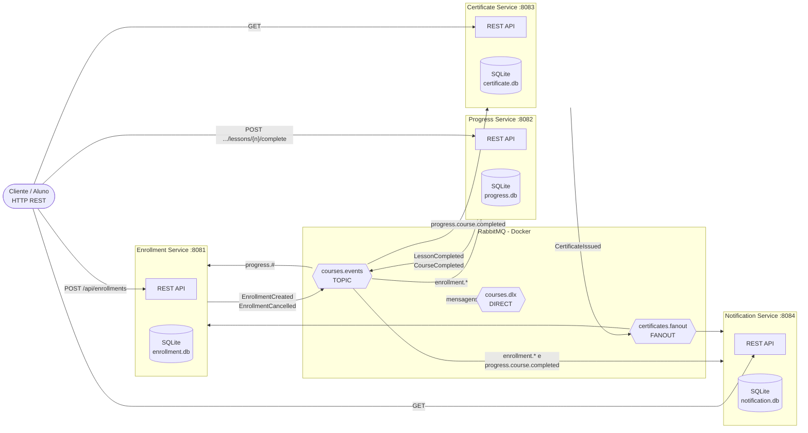
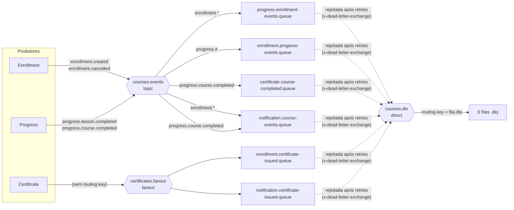
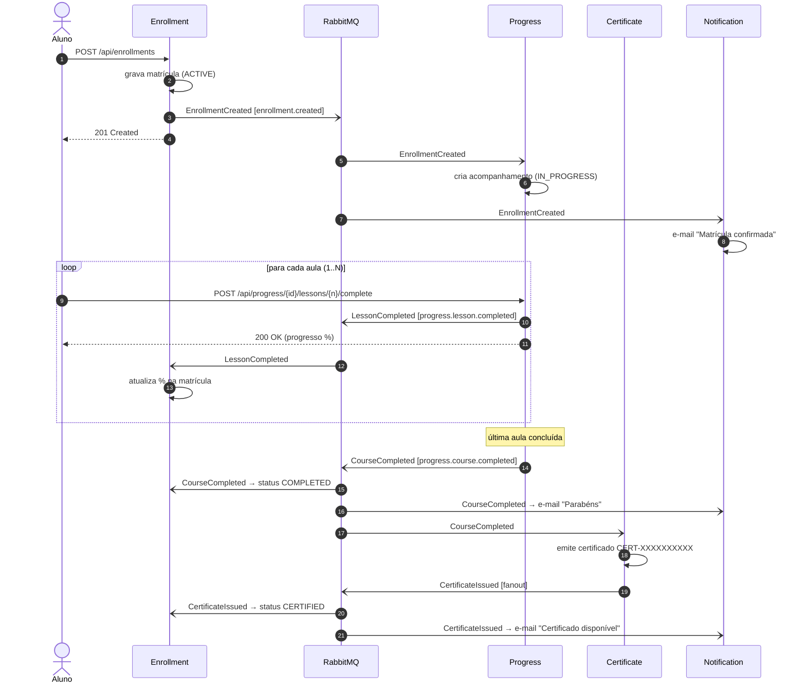
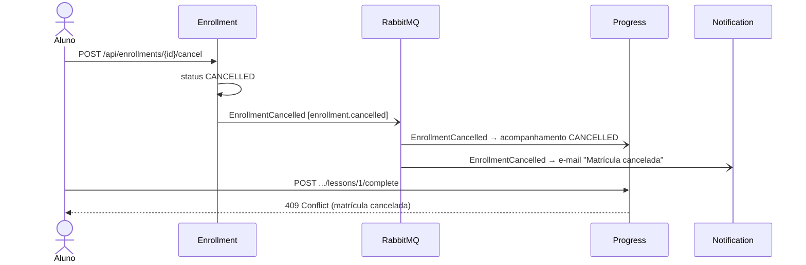
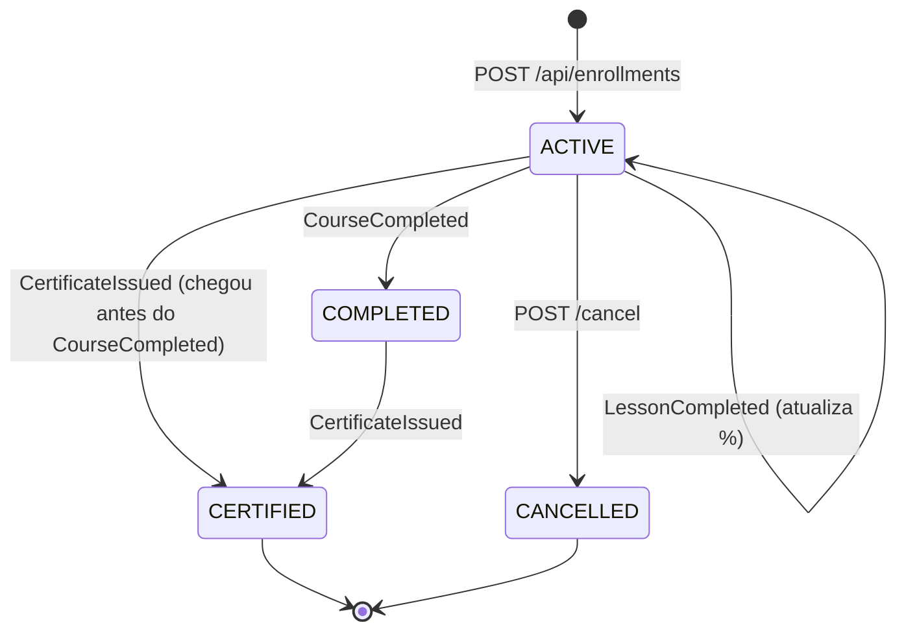
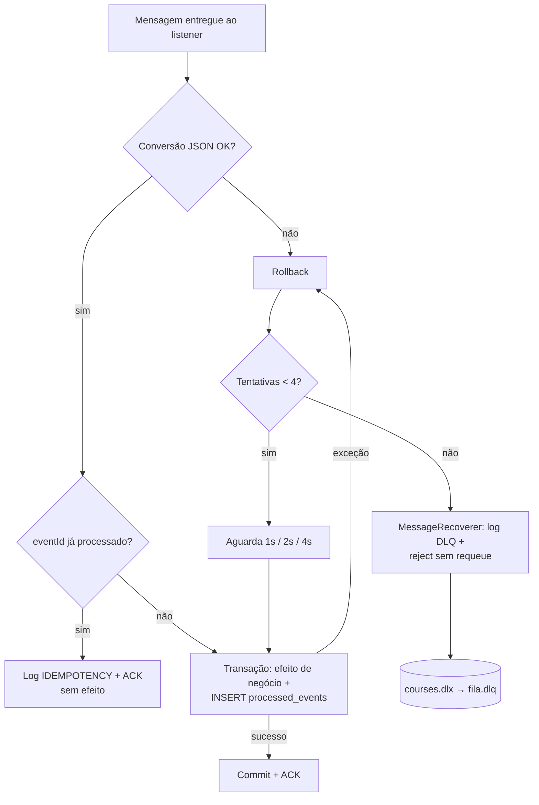

# Documentação Arquitetural — Sistema de Gerenciamento de Cursos Online

**Disciplina:** Sistemas Baseados em Eventos e Mensageria Distribuída
**Tema:** Proposta 04 — Sistema de Gerenciamento de Cursos Online
**Stack:** Java 21 · Spring Boot 4.1 · Spring AMQP · Spring Web · Spring Data JPA · SQLite · RabbitMQ 3 (Docker) · Docker Compose

---

## Sumário

1. [Introdução](#1-introdução)
2. [Arquitetura](#2-arquitetura)
3. [Decisões Técnicas](#3-decisões-técnicas)
4. [Eventos](#4-eventos)
5. [Endpoints](#5-endpoints)
6. [Configuração](#6-configuração)
7. [Tratamento de Erros e Confiabilidade](#7-tratamento-de-erros-e-confiabilidade)
8. [Diferenciais Implementados](#8-diferenciais-implementados-seção-14)
9. [Testes Automatizados](#9-testes-automatizados)
10. [Limitações e Evoluções Futuras](#10-limitações-e-evoluções-futuras)

---

## 1. Introdução

### 1.1 Descrição do problema

Uma plataforma de cursos online precisa coordenar várias etapas da jornada do aluno:

1. o aluno **se matricula** em um curso;
2. conforme assiste às aulas, seu **progresso** é registrado;
3. ao concluir todas as aulas, um **certificado** é emitido;
4. o aluno é **notificado** em cada marco (matrícula, conclusão, certificado, cancelamento).

Cada etapa pertence a uma área de negócio diferente, com regras, dados e ritmo de evolução próprios.
Em uma solução monolítica ou baseada apenas em chamadas síncronas (REST entre serviços), essas áreas
ficariam fortemente acopladas: a indisponibilidade do serviço de certificados impediria a conclusão
de uma aula, e adicionar um novo interessado (por exemplo, um serviço de gamificação) exigiria alterar
o código de quem produz a informação.

### 1.2 Objetivos do sistema

| # | Objetivo |
|---|----------|
| 1 | Gerenciar o catálogo de cursos e as matrículas dos alunos |
| 2 | Acompanhar o progresso aula a aula de cada matrícula |
| 3 | Emitir automaticamente um certificado único quando o aluno conclui o curso |
| 4 | Notificar o aluno a cada evento relevante |
| 5 | Manter cada serviço **independente** (código, banco de dados e implantação próprios), comunicando-se apenas por eventos |
| 6 | Ser **resiliente** a falhas temporárias (retry, DLQ) e a mensagens duplicadas (idempotência) |

### 1.3 Motivação para usar EDA

A Arquitetura Orientada a Eventos (EDA) resolve os problemas acima da seguinte forma:

- **Desacoplamento temporal:** o Progress Service publica `CourseCompleted` e responde ao aluno imediatamente.
  Se o Certificate Service estiver fora do ar, o evento fica armazenado na fila e é processado quando ele voltar.
- **Desacoplamento de conhecimento:** o produtor não sabe quem consome seus eventos. O Notification Service
  foi adicionado sem nenhuma alteração nos demais serviços — bastou criar filas e bindings.
- **Escalabilidade independente:** cada serviço pode ter múltiplas instâncias consumindo da mesma fila
  (competing consumers).
- **Autonomia de dados:** cada serviço mantém uma cópia local dos dados de que precisa (por exemplo, o Progress
  Service guarda nome/e-mail do aluno recebidos em `EnrollmentCreated`), sem consultar o banco de outro serviço.
- **Rastreabilidade:** cada fato de negócio vira um evento imutável com `eventId` e `occurredAt`, o que facilita
  auditoria e depuração.

---

## 2. Arquitetura

### 2.1 Diagrama de componentes



### 2.2 Topologia do RabbitMQ (exchanges, bindings e filas)



| Fila | Exchange | Binding | Serviço consumidor | Eventos recebidos |
|------|----------|---------|--------------------|-------------------|
| `progress.enrollment-events.queue` | `courses.events` (topic) | `enrollment.*` | Progress | EnrollmentCreated, EnrollmentCancelled |
| `enrollment.progress-events.queue` | `courses.events` (topic) | `progress.#` | Enrollment | LessonCompleted, CourseCompleted |
| `certificate.course-completed.queue` | `courses.events` (topic) | `progress.course.completed` | Certificate | CourseCompleted |
| `notification.course-events.queue` | `courses.events` (topic) | `enrollment.*` **e** `progress.course.completed` | Notification | EnrollmentCreated, EnrollmentCancelled, CourseCompleted |
| `enrollment.certificate-issued.queue` | `certificates.fanout` (fanout) | — | Enrollment | CertificateIssued |
| `notification.certificate-issued.queue` | `certificates.fanout` (fanout) | — | Notification | CertificateIssued |
| `<fila>.dlq` (6 filas) | `courses.dlx` (direct) | `<fila>.dlq` | — (análise manual) | Mensagens que falharam |

> Todas as filas e exchanges são **duráveis** e as mensagens são publicadas como **persistentes**:
> sobrevivem a um reinício do broker (o volume `rabbitmq_data` é persistido pelo Docker Compose).

### 2.3 Fluxo de eventos (caminho feliz)



### 2.4 Fluxo alternativo: cancelamento



### 2.5 Ciclo de vida da matrícula (visão do Enrollment Service)



### 2.6 Descrição dos serviços

| Serviço | Porta | Responsabilidade | Publica | Consome | Banco |
|---------|-------|------------------|---------|---------|-------|
| **Enrollment Service** | 8081 | Catálogo de cursos e matrículas; ponto de entrada do fluxo | `EnrollmentCreated`, `EnrollmentCancelled` | `LessonCompleted`, `CourseCompleted`, `CertificateIssued` | `enrollment.db` (tabelas `courses`, `enrollments`, `processed_events`) |
| **Progress Service** | 8082 | Registra aulas concluídas e detecta a conclusão do curso | `LessonCompleted`, `CourseCompleted` | `EnrollmentCreated`, `EnrollmentCancelled` | `progress.db` (`course_progress`, `lesson_completions`, `processed_events`) |
| **Certificate Service** | 8083 | Emite um certificado único por matrícula concluída | `CertificateIssued` | `CourseCompleted` | `certificate.db` (`certificates`, `processed_events`) |
| **Notification Service** *(serviço extra)* | 8084 | Envia (simula) e-mails ao aluno e guarda o histórico | — | `EnrollmentCreated`, `EnrollmentCancelled`, `CourseCompleted`, `CertificateIssued` | `notification.db` (`notifications`, `processed_events`) |

**Organização interna de cada serviço** (pacotes em `br.com.cursosonline.<serviço>`):

| Pacote | Conteúdo |
|--------|----------|
| `config` | Topologia RabbitMQ (`RabbitMQConfig`) e propriedades tipadas (`RabbitTopologyProperties`) |
| `domain` | Entidades JPA e repositórios Spring Data |
| `event` | Contratos dos eventos (Java `record`s imutáveis) |
| `messaging` | Listeners `@RabbitListener`, `EventPublisher`, conversor JSON e suporte a DLQ |
| `service` | Regras de negócio / casos de uso (transacionais) |
| `idempotency` | Tabela `processed_events` e `IdempotencyGuard` |
| `web` | Controllers REST, DTOs e `GlobalExceptionHandler` (Problem Details) |
| `exception` | Exceções de negócio |

Os listeners são finos: registram o recebimento no log e delegam para a camada `service`, que é
transacional. Isso separa a infraestrutura de mensageria das regras de negócio e facilita os testes.

---

## 3. Decisões Técnicas

### 3.1 Escolha do broker: RabbitMQ

| Critério | Justificativa |
|----------|---------------|
| Roteamento flexível | Exchanges `direct`, `fanout` e `topic` permitem expressar no broker quem recebe cada evento, sem lógica no produtor |
| Garantias de entrega | Filas duráveis, mensagens persistentes, publisher confirms e ACK manual/automático após processamento |
| Tratamento de falhas nativo | Dead Letter Exchange (`x-dead-letter-exchange`) sem código adicional |
| Integração com Spring | Spring AMQP oferece `RabbitTemplate`, `@RabbitListener`, conversão JSON e retry declarativo |
| Operação | Painel de gerenciamento (porta 15672) para inspecionar filas, bindings e mensagens |
| Adequação ao volume | Para eventos de negócio (baixa/média vazão, necessidade de roteamento), RabbitMQ é mais simples de operar que Kafka; não precisamos de replay de log nem de retenção longa |

### 3.2 Tipos de exchange utilizados (três tipos)

| Exchange | Tipo | Por que este tipo |
|----------|------|-------------------|
| `courses.events` | **Topic** | Barramento principal de eventos de domínio. As routing keys seguem o padrão `<contexto>.<entidade>.<ação>` (ex.: `progress.course.completed`) e os consumidores escolhem o que querem com curingas: `enrollment.*` (todos os eventos de matrícula), `progress.#` (todos os eventos de progresso) ou uma chave exata. Novos eventos entram sem alterar consumidores existentes. |
| `certificates.fanout` | **Fanout** | `CertificateIssued` é um *broadcast*: **todos** os interessados devem receber uma cópia, independentemente de routing key. Hoje são o Enrollment e o Notification; qualquer novo serviço (ex.: gamificação, LinkedIn) só precisa ligar uma fila ao exchange. |
| `courses.dlx` | **Direct** | Dead Letter Exchange. Cada fila principal envia suas mensagens rejeitadas com a routing key `<fila>.dlq`, e o exchange direct as entrega exatamente na DLQ correspondente — roteamento 1:1, sem ambiguidade. |

### 3.3 Padrões de mensageria aplicados

| Padrão | Onde / como |
|--------|-------------|
| **Publish/Subscribe** | Topic e fanout: um evento, vários consumidores independentes |
| **Event Notification + Event-Carried State Transfer** | Os eventos carregam os dados necessários (nome, e-mail, curso, total de aulas), de modo que os consumidores não precisam consultar o produtor |
| **Consumidor idempotente** | Tabela `processed_events` (PK = `eventId`) gravada na mesma transação do efeito de negócio |
| **Retry com backoff exponencial** | Interceptor de retry do Spring AMQP: 1s → 2s → 4s |
| **Dead Letter Queue** | Após esgotar as tentativas, a mensagem é rejeitada sem requeue e o broker a move para `<fila>.dlq` |
| **Publisher Confirms / Returns** | O broker confirma cada publicação (`correlated`) e devolve mensagens sem rota (`mandatory`); ambos são registrados em log |
| **Competing Consumers** | Filas nomeadas e duráveis permitem escalar horizontalmente cada serviço |
| **Database per Service** | Cada serviço tem seu próprio arquivo SQLite; nenhum serviço acessa o banco de outro |
| **Tolerant Reader** | O `JsonMapper` do Spring Boot ignora campos desconhecidos, permitindo evoluir eventos adicionando campos |

### 3.4 Formato das mensagens e contrato entre serviços

- **JSON** (`content_type: application/json`), serializado com Jackson 3 (`JacksonJsonMessageConverter`).
- Datas em **ISO-8601 UTC** (`"2026-08-01T10:00:00Z"`).
- O header `__TypeId__` carrega um **nome lógico** (`EnrollmentCreated`) — e não o nome da classe Java.
  Cada serviço mapeia esse nome para o seu próprio `record` (`EventMessageConverterFactory`). Assim:
  - **não existe biblioteca compartilhada** entre os serviços (desacoplamento de build e de implantação);
  - tipos não mapeados **não são desserializados** (proteção contra desserialização arbitrária — coberto por teste).
- Header `message_id` = `eventId` e `app_id` = nome do serviço de origem (visíveis no RabbitMQ Management).

### 3.5 Persistência: SQLite

- SQLite foi escolhido no lugar do H2 (diferencial +1): banco em **arquivo**, sem servidor, que persiste entre execuções.
- Driver `org.xerial:sqlite-jdbc` + dialeto `org.hibernate.community.dialect.SQLiteDialect` (Hibernate 7).
- `spring.jpa.hibernate.ddl-auto=update` cria as tabelas automaticamente.
- Pool Hikari com **1 conexão**: o SQLite permite um único escritor por vez; serializar o acesso evita
  erros `database is locked` entre as threads HTTP e as threads dos listeners.
- O diretório é configurável pela variável `DATA_DIR` (padrão `./data`; nos containers, `/app/data` em volume Docker).

### 3.6 Consistência entre banco e broker

No produtor, a gravação no banco e a publicação ocorrem **dentro da mesma transação** (`@Transactional`):
se o RabbitMQ estiver indisponível, `convertAndSend` lança `AmqpException`, a transação sofre rollback e o
cliente recebe **HTTP 503** — nunca fica uma matrícula gravada sem o evento correspondente. A limitação
remanescente (falha no commit do banco *depois* de publicar) e a solução definitiva (Transactional Outbox)
estão descritas na [seção 10](#10-limitações-e-evoluções-futuras).

### 3.7 Ordenação de eventos

O RabbitMQ garante ordem apenas **dentro de uma fila**. Como `CourseCompleted` (via topic) e `CertificateIssued`
(via fanout) chegam ao Enrollment Service por filas diferentes, o certificado pode chegar primeiro. O código
trata isso: `CourseCompleted` só move a matrícula para `COMPLETED` se ela ainda estiver `ACTIVE` (nunca
"rebaixa" um `CERTIFIED`), e `LessonCompleted` com contagem menor que a atual é ignorado.

### 3.8 Versões

| Componente | Versão | Observação |
|------------|--------|------------|
| Java | 21 (LTS) | `maven.compiler.release=21`; imagens `eclipse-temurin:21` |
| Spring Boot | 4.1.1 | Starters `webmvc`, `amqp`, `data-jpa`, `validation`, `actuator` |
| Spring AMQP | 4.1.x | Gerenciado pelo Spring Boot |
| Hibernate ORM | 7.x | + `hibernate-community-dialects` para SQLite |
| SQLite JDBC | 3.53.4.0 | |
| RabbitMQ | 3-management-alpine | Imagem indicada no enunciado |

---

## 4. Eventos

Todos os eventos implementam `DomainEvent` e possuem os campos comuns:

| Campo | Tipo | Descrição |
|-------|------|-----------|
| `eventId` | string (UUID) | Identificador único do evento — chave de idempotência |
| `occurredAt` | string (ISO-8601) | Instante em que o fato ocorreu |

### 4.1 `EnrollmentCreated`

| | |
|---|---|
| **Produtor** | Enrollment Service |
| **Exchange / routing key** | `courses.events` / `enrollment.created` |
| **Consumidores** | Progress (cria o acompanhamento), Notification (e-mail de boas-vindas) |
| **Descrição** | Um aluno foi matriculado em um curso |

| Campo | Tipo | Descrição |
|-------|------|-----------|
| `enrollmentId` | long | Identificador da matrícula |
| `studentId` | string | Identificador do aluno |
| `studentName` | string | Nome do aluno |
| `studentEmail` | string | E-mail do aluno |
| `courseId` | string | Código do curso (ex.: `EDA-101`) |
| `courseName` | string | Nome do curso |
| `totalLessons` | int | Quantidade de aulas do curso |

```json
{
  "eventId": "ac9698d8-37bb-4b6f-947e-ad96e4175c26",
  "occurredAt": "2026-09-26T15:46:57.847Z",
  "enrollmentId": 1,
  "studentId": "aluno-1",
  "studentName": "Maria Silva",
  "studentEmail": "maria@email.com",
  "courseId": "EDA-101",
  "courseName": "Arquitetura Orientada a Eventos com RabbitMQ",
  "totalLessons": 3
}
```

### 4.2 `EnrollmentCancelled`

| | |
|---|---|
| **Produtor** | Enrollment Service |
| **Exchange / routing key** | `courses.events` / `enrollment.cancelled` |
| **Consumidores** | Progress (bloqueia novas aulas), Notification (e-mail de cancelamento) |
| **Descrição** | Uma matrícula ativa foi cancelada |

| Campo | Tipo | Descrição |
|-------|------|-----------|
| `enrollmentId` | long | Matrícula cancelada |
| `studentId`, `studentName`, `studentEmail` | string | Dados do aluno |
| `courseId`, `courseName` | string | Dados do curso |
| `reason` | string | Motivo do cancelamento |

### 4.3 `LessonCompleted`

| | |
|---|---|
| **Produtor** | Progress Service |
| **Exchange / routing key** | `courses.events` / `progress.lesson.completed` |
| **Consumidores** | Enrollment (atualiza o percentual na matrícula) |
| **Descrição** | O aluno concluiu uma aula |

| Campo | Tipo | Descrição |
|-------|------|-----------|
| `enrollmentId` | long | Matrícula |
| `studentId`, `courseId` | string | Aluno e curso |
| `lessonNumber` | int | Número da aula concluída |
| `completedLessons` | int | Total de aulas concluídas até agora |
| `totalLessons` | int | Total de aulas do curso |
| `progressPercentage` | int | Percentual concluído (0–100) |

```json
{
  "eventId": "8b857c6f-a6ec-4f43-acdc-78fce81b4c00",
  "occurredAt": "2026-09-26T15:47:00.273Z",
  "enrollmentId": 1,
  "studentId": "aluno-1",
  "courseId": "EDA-101",
  "lessonNumber": 1,
  "completedLessons": 1,
  "totalLessons": 3,
  "progressPercentage": 33
}
```

### 4.4 `CourseCompleted`

| | |
|---|---|
| **Produtor** | Progress Service |
| **Exchange / routing key** | `courses.events` / `progress.course.completed` |
| **Consumidores** | Certificate (emite o certificado), Enrollment (status `COMPLETED`), Notification (e-mail de parabéns) |
| **Descrição** | O aluno concluiu todas as aulas do curso |

| Campo | Tipo | Descrição |
|-------|------|-----------|
| `enrollmentId` | long | Matrícula |
| `studentId`, `studentName`, `studentEmail` | string | Dados do aluno |
| `courseId`, `courseName` | string | Dados do curso |
| `totalLessons` | int | Total de aulas concluídas |
| `completedAt` | string (ISO-8601) | Momento da conclusão |

### 4.5 `CertificateIssued`

| | |
|---|---|
| **Produtor** | Certificate Service |
| **Exchange / routing key** | `certificates.fanout` / *(ignorada — fanout)* |
| **Consumidores** | Enrollment (status `CERTIFIED` + código), Notification (e-mail com o código) |
| **Descrição** | Um certificado de conclusão foi emitido |

| Campo | Tipo | Descrição |
|-------|------|-----------|
| `certificateId` | long | Identificador interno do certificado |
| `certificateCode` | string | Código público de verificação (ex.: `CERT-9FDAA4CF25`) |
| `enrollmentId` | long | Matrícula certificada |
| `studentId`, `studentName`, `studentEmail` | string | Dados do aluno |
| `courseId`, `courseName` | string | Dados do curso |
| `issuedAt` | string (ISO-8601) | Momento da emissão |

### 4.6 Headers AMQP publicados

| Header / propriedade | Exemplo | Uso |
|----------------------|---------|-----|
| `__TypeId__` | `CourseCompleted` | Seleciona o `record` na desserialização e o `@RabbitHandler` |
| `message_id` | `4f684466-...` (= `eventId`) | Rastreamento no RabbitMQ Management e nos logs de DLQ |
| `app_id` | `progress-service` | Serviço de origem |
| `content_type` | `application/json` | Formato do payload |
| `delivery_mode` | `2` (persistente) | Sobrevive a reinício do broker |

---

## 5. Endpoints

Todos os erros seguem o formato **Problem Details (RFC 9457)**:

```json
{ "title": "Regra de negócio violada", "status": 409,
  "detail": "Aula 1 já foi concluída na matrícula 1", "instance": "/api/progress/1/lessons/1/complete" }
```

### 5.1 Enrollment Service — `http://localhost:8081`

| Método | Rota | Descrição | Respostas |
|--------|------|-----------|-----------|
| GET | `/api/courses` | Lista o catálogo de cursos | 200 |
| **POST** | **`/api/enrollments`** | **Cria matrícula e publica `EnrollmentCreated` (inicia o fluxo)** | 201, 400, 404, 409, 503 |
| GET | `/api/enrollments?studentId=` | Lista matrículas (filtro opcional por aluno) | 200 |
| GET | `/api/enrollments/{id}` | Detalha a matrícula (status, % de progresso, código do certificado) | 200, 404 |
| POST | `/api/enrollments/{id}/cancel` | Cancela matrícula `ACTIVE` e publica `EnrollmentCancelled`. Corpo opcional `{"reason": "..."}` | 200, 404, 409, 503 |

Corpo de `POST /api/enrollments`:

```json
{ "studentId": "aluno-1", "studentName": "Maria Silva", "studentEmail": "maria@email.com", "courseId": "EDA-101" }
```

Validações: todos os campos obrigatórios; `studentEmail` deve ser um e-mail válido; o curso deve existir (404);
o aluno não pode ter outra matrícula não cancelada no mesmo curso (409).

Cursos pré-cadastrados: `EDA-101` (3 aulas), `JAVA-201` (5 aulas), `SPRING-301` (4 aulas).

### 5.2 Progress Service — `http://localhost:8082`

| Método | Rota | Descrição | Respostas |
|--------|------|-----------|-----------|
| GET | `/api/progress?studentId=` | Lista acompanhamentos | 200 |
| GET | `/api/progress/{enrollmentId}` | Progresso de uma matrícula | 200, 404 |
| GET | `/api/progress/{enrollmentId}/lessons` | Aulas concluídas | 200, 404 |
| **POST** | **`/api/progress/{enrollmentId}/lessons/{lessonNumber}/complete`** | **Conclui uma aula; publica `LessonCompleted` e, na última, `CourseCompleted`** | 200, 400, 404, 409, 503 |

Regras: aula entre 1 e `totalLessons` (400); cada aula só pode ser concluída uma vez (409); matrícula
cancelada ou já concluída não aceita aulas (409); 404 se o `EnrollmentCreated` ainda não foi processado.

### 5.3 Certificate Service — `http://localhost:8083`

| Método | Rota | Descrição | Respostas |
|--------|------|-----------|-----------|
| GET | `/api/certificates?studentId=` | Lista certificados | 200 |
| GET | `/api/certificates/{code}` | Verifica a autenticidade de um certificado pelo código | 200, 404 |
| GET | `/api/certificates/enrollment/{enrollmentId}` | Certificado de uma matrícula | 200, 404 |

### 5.4 Notification Service — `http://localhost:8084`

| Método | Rota | Descrição | Respostas |
|--------|------|-----------|-----------|
| GET | `/api/notifications?recipient=` | Histórico de notificações (filtro opcional por e-mail) | 200 |

### 5.5 Saúde

Todos os serviços expõem `GET /actuator/health` (Spring Boot Actuator), com o detalhamento do estado da
conexão com o RabbitMQ (`rabbit`) e com o banco SQLite (`db`).

---

## 6. Configuração

### 6.1 Docker Compose

O arquivo [`docker-compose.yml`](../docker-compose.yml) define 5 containers na mesma rede:

| Serviço | Imagem | Portas | Volume | Observação |
|---------|--------|--------|--------|------------|
| `rabbitmq` | `rabbitmq:3-management-alpine` | 5672 (AMQP), 15672 (Management) | `rabbitmq_data` | Usuário/senha `admin`/`admin`; healthcheck `rabbitmq-diagnostics check_port_connectivity` |
| `enrollment-service` | build `./enrollment-service` | 8081 | `enrollment_data:/app/data` | |
| `progress-service` | build `./progress-service` | 8082 | `progress_data:/app/data` | |
| `certificate-service` | build `./certificate-service` | 8083 | `certificate_data:/app/data` | |
| `notification-service` | build `./notification-service` | 8084 | `notification_data:/app/data` | |

- Os serviços usam `depends_on: condition: service_healthy`, ou seja, só iniciam após o RabbitMQ estar pronto.
- `SPRING_RABBITMQ_HOST=rabbitmq` sobrescreve `spring.rabbitmq.host=localhost` (relaxed binding do Spring Boot),
  porque dentro da rede Docker o broker é acessado pelo nome do serviço.
- `DATA_DIR=/app/data` aponta o SQLite para o volume nomeado, preservando os dados entre recriações.
- A chave `version:` foi omitida porque está obsoleta no Docker Compose v2.

Modos de execução:

```bash
docker compose up -d rabbitmq      # somente o broker (serviços na IDE ou via ./mvnw spring-boot:run)
docker compose up -d --build       # broker + 4 serviços containerizados
docker compose down                # para tudo (mantém dados)
docker compose down -v             # para tudo e APAGA filas e bancos
```

**Dockerfile** (igual para os 4 serviços, *multi-stage*):

1. `maven:3.9-eclipse-temurin-21` — baixa dependências (camada em cache) e gera o `.jar`;
2. `eclipse-temurin:21-jre-alpine` — imagem final enxuta, executada com **usuário não-root**.

### 6.2 Configuração de cada serviço (`application.properties`)

Propriedades comuns aos quatro serviços:

```properties
# RabbitMQ (Docker local)
spring.rabbitmq.host=localhost
spring.rabbitmq.port=5672
spring.rabbitmq.username=admin
spring.rabbitmq.password=admin
spring.rabbitmq.connection-timeout=10000

# Publisher confirms + returns (serviços que publicam)
spring.rabbitmq.publisher-confirm-type=correlated
spring.rabbitmq.publisher-returns=true
spring.rabbitmq.template.mandatory=true

# Consumo: falha definitiva -> reject sem requeue -> DLQ
spring.rabbitmq.listener.simple.acknowledge-mode=auto
spring.rabbitmq.listener.simple.default-requeue-rejected=false
spring.rabbitmq.listener.simple.prefetch=10

# Retry com backoff exponencial: 1s, 2s, 4s
spring.rabbitmq.listener.simple.retry.enabled=true
spring.rabbitmq.listener.simple.retry.initial-interval=1s
spring.rabbitmq.listener.simple.retry.multiplier=2
spring.rabbitmq.listener.simple.retry.max-interval=10s
spring.rabbitmq.listener.simple.retry.max-retries=3

# SQLite
spring.datasource.url=jdbc:sqlite:${DATA_DIR:./data}/<servico>.db
spring.datasource.driver-class-name=org.sqlite.JDBC
spring.datasource.hikari.maximum-pool-size=1
spring.jpa.database-platform=org.hibernate.community.dialect.SQLiteDialect
spring.jpa.hibernate.ddl-auto=update
spring.jpa.open-in-view=false
```

Propriedades específicas (topologia):

| Serviço | Propriedades `app.rabbitmq.*` |
|---------|-------------------------------|
| Enrollment | `routing-keys.enrollment-created=enrollment.created`, `routing-keys.enrollment-cancelled=enrollment.cancelled`, `routing-keys.progress-events=progress.#`, `queues.progress-events=enrollment.progress-events.queue`, `queues.certificate-issued=enrollment.certificate-issued.queue` |
| Progress | `routing-keys.lesson-completed=progress.lesson.completed`, `routing-keys.course-completed=progress.course.completed`, `routing-keys.enrollment-events=enrollment.*`, `queues.enrollment-events=progress.enrollment-events.queue` |
| Certificate | `routing-keys.course-completed=progress.course.completed`, `queues.course-completed=certificate.course-completed.queue` |
| Notification | `routing-keys.enrollment-events=enrollment.*`, `routing-keys.course-completed=progress.course.completed`, `queues.course-events=notification.course-events.queue`, `queues.certificate-issued=notification.certificate-issued.queue`; `app.notification.simulated-failure-domain=falha.com` |

Todos compartilham `events-exchange=courses.events`, `certificates-exchange=certificates.fanout` e
`dead-letter-exchange=courses.dlx`. As propriedades são lidas pelo `record` `RabbitTopologyProperties`
(`@ConfigurationProperties`) e os nomes de fila são usados em `@RabbitListener(queues = "${...}")`.

**Quem declara o quê:** cada serviço declara (idempotentemente, via `RabbitAdmin`) os exchanges que usa e
**as filas que consome**, com seus bindings e DLQs. Assim, o dono da fila é o consumidor, e o produtor não
precisa conhecer quem o escuta.

### 6.3 Variáveis de ambiente úteis

| Variável | Padrão | Efeito |
|----------|--------|--------|
| `SPRING_RABBITMQ_HOST` | `localhost` | Host do broker |
| `DATA_DIR` | `./data` | Diretório dos arquivos SQLite |
| `SERVER_PORT` | 8081–8084 | Porta HTTP do serviço |
| `APP_NOTIFICATION_SIMULATED_FAILURE_DOMAIN` | `falha.com` | Domínio de e-mail que simula falha no Notification Service |

---

## 7. Tratamento de Erros e Confiabilidade

### 7.1 Na API REST (síncrono)

| Situação | HTTP | Onde |
|----------|------|------|
| Campos inválidos (Bean Validation) | 400 + mapa `errors` | `GlobalExceptionHandler.handleMethodArgumentNotValid` |
| Aula fora do intervalo / argumento inválido | 400 | `IllegalArgumentException` |
| Recurso inexistente | 404 | `ResourceNotFoundException` |
| Regra de negócio (duplicidade, estado inválido) | 409 | `BusinessRuleException` |
| RabbitMQ indisponível ao publicar | 503 (transação desfeita) | `AmqpException` |
| Erro inesperado | 500 (logado com stack trace) | `Exception` |

### 7.2 No consumo de mensagens (assíncrono)



- **Retry com backoff exponencial:** até 3 retentativas (4 tentativas no total), com intervalos de 1s, 2s e 4s
  (`multiplier=2`, teto `max-interval=10s`). O retry é *stateless*, feito na própria thread do consumidor.
- **DLQ:** esgotadas as tentativas, o `MessageRecoverer` (`DeadLetterSupport.loggingRecoverer`) registra
  `messageId`, fila, tipo e causa raiz, e rejeita a mensagem sem requeue. O RabbitMQ a republica no
  `courses.dlx` com a routing key `<fila>.dlq`. A mensagem preserva o payload original e ganha o header
  `x-death` (motivo, fila de origem, quantidade), podendo ser inspecionada e reenviada pelo RabbitMQ Management
  (*Queues → <fila>.dlq → Get messages / Move messages*).
- **Idempotência:** `IdempotencyGuard.firstTime(event)` roda com `Propagation.MANDATORY`, ou seja, obrigatoriamente
  dentro da transação do handler. O registro em `processed_events` e o efeito de negócio são confirmados juntos,
  e o ACK só é enviado depois do commit. Uma reentrega (*at-least-once*) é, portanto, detectada e ignorada.
  O Certificate Service tem ainda uma segunda barreira de negócio: restrição única em `certificates.enrollment_id`
  ("um certificado por matrícula"), que cobre eventos **diferentes** referentes à mesma conclusão.
- **Mensagens inválidas / tipos desconhecidos:** `EnrollmentCreated` com `totalLessons <= 0` lança
  `InvalidEventException`; tipos fora do mapeamento são recusados pelo conversor. Ambos terminam na DLQ.
- **Referências a entidades inexistentes** (ex.: progresso de matrícula desconhecida) são registradas com `WARN`
  e descartadas — não adianta reprocessar.

### 7.3 Como demonstrar retry e DLQ

O Notification Service simula um provedor de e-mail fora do ar para destinatários `@falha.com`:

```bash
curl -X POST http://localhost:8081/api/enrollments -H "Content-Type: application/json" \
  -d '{"studentId":"a9","studentName":"Joao","studentEmail":"joao@falha.com","courseId":"JAVA-201"}'
```

Log do Notification Service:

```
12:40:38.935 ERROR ... EmailGateway  : [EMAIL] Falha simulada ao enviar e-mail para joao@falha.com
12:40:39.966 ERROR ... EmailGateway  : [EMAIL] Falha simulada ao enviar e-mail para joao@falha.com   (+1s)
12:40:41.978 ERROR ... EmailGateway  : [EMAIL] Falha simulada ao enviar e-mail para joao@falha.com   (+2s)
12:40:45.982 ERROR ... EmailGateway  : [EMAIL] Falha simulada ao enviar e-mail para joao@falha.com   (+4s)
12:40:45.982 ERROR ... DeadLetterSupport : [DLQ] Retentativas esgotadas: messageId=f3363548-... fila=notification.course-events.queue tipo=EnrollmentCreated -> enviada para DLQ. Causa: NotificationDeliveryException: Provedor de e-mail indisponível para joao@falha.com
```

Note que **os outros consumidores do mesmo evento não são afetados**: o Progress Service processou o
`EnrollmentCreated` normalmente — isolamento de falhas proporcionado pela EDA.

### 7.4 Logs detalhados

Cada etapa registra uma linha com prefixo padronizado, facilitando filtrar o fluxo (`docker logs <serviço> | grep "\[PUBLISH\]"`):

| Prefixo | Significado |
|---------|-------------|
| `[PUBLISH]` | Evento publicado (tipo, eventId, exchange, routing key e payload) |
| `[CONFIRM]` | Confirmação do broker (publisher confirm) — nível DEBUG em caso de sucesso, ERROR em caso de NACK |
| `[RETURN]` | Evento sem fila de destino (mandatory) |
| `[CONSUME]` | Evento recebido por um listener |
| `[ENROLLMENT]`, `[PROGRESS]`, `[CERTIFICATE]`, `[NOTIFICATION]` | Efeito de negócio aplicado |
| `[EMAIL]` | Envio (simulado) de e-mail |
| `[IDEMPOTENCY]` | Evento duplicado ignorado |
| `[DLQ]` | Mensagem enviada para a Dead Letter Queue |
| `[HTTP 4xx/5xx]` | Erros na API REST |

Exemplo real de um fluxo completo (matrícula 1):

```
[enrollment]   [ENROLLMENT] Matrícula id=1 criada: aluno=aluno-6551 curso=EDA-101 (3 aulas)
[enrollment]   [PUBLISH] EnrollmentCreated eventId=ac9698d8-... -> exchange='courses.events' routingKey='enrollment.created'
[progress]     [CONSUME] EnrollmentCreated eventId=ac9698d8-... matrícula=1 curso=EDA-101
[progress]     [PROGRESS] Acompanhamento id=1 criado para matrícula 1 (curso EDA-101, 3 aulas)
[notification] [EMAIL] Para: aluno-6551@email.com | Assunto: Matrícula confirmada: Arquitetura Orientada a Eventos com RabbitMQ
[progress]     [PROGRESS] Matrícula 1 concluiu a aula 1 -> 1/3 aulas (33%)
[progress]     [PUBLISH] LessonCompleted eventId=8b857c6f-... -> exchange='courses.events' routingKey='progress.lesson.completed'
[enrollment]   [CONSUME] LessonCompleted eventId=8b857c6f-... matrícula=1 aula=1
[enrollment]   [ENROLLMENT] Matrícula id=1 progresso atualizado: 1/3 aulas (33%)
...
[certificate]  [CONSUME] CourseCompleted eventId=4f684466-... matrícula=1 aluno=aluno-6551 curso=EDA-101
[certificate]  [CERTIFICATE] Certificado CERT-9FDAA4CF25 emitido para Aluno Demo no curso 'Arquitetura Orientada a Eventos com RabbitMQ' (matrícula 1)
[certificate]  [PUBLISH] CertificateIssued eventId=5e605090-... -> exchange='certificates.fanout' routingKey=''
[notification] [CONSUME] CertificateIssued eventId=5e605090-... certificado=CERT-9FDAA4CF25
[notification] [NOTIFICATION] Notificação id=3 (CertificateIssued) registrada para aluno-6551@email.com
```

---

## 8. Diferenciais Implementados (seção 14)

| # | Diferencial | Pontos | Implementação | Onde ver |
|---|-------------|--------|---------------|----------|
| 1 | **Dead Letter Queue** | +2 | Toda fila tem `x-dead-letter-exchange=courses.dlx` e uma DLQ `<fila>.dlq` (6 DLQs); recoverer que loga e rejeita | `messaging/DeadLetterSupport.java`, `config/RabbitMQConfig.java` |
| 2 | **Idempotência** | +2 | Tabela `processed_events` (PK `eventId`) na mesma transação do efeito; + regra "um certificado por matrícula" | `idempotency/IdempotencyGuard.java`, `CertificateService.issueFor` |
| 3 | **Retry com Backoff** | +1 | Retry exponencial 1s → 2s → 4s antes da DLQ | `application.properties` (`spring.rabbitmq.listener.simple.retry.*`) |
| 4 | **Mais de 3 serviços** | +2 | 4º serviço: **Notification Service** | `notification-service/` |
| 5 | **Testes Automatizados** | +2 | 29 testes (JUnit 5 + Mockito + AssertJ) nos 4 serviços | `*/src/test/java`, `./mvnw verify` |
| 6 | **Containerização Completa** | +2 | Dockerfile multi-stage por serviço + `docker compose up -d --build` sobe tudo | `*/Dockerfile`, `docker-compose.yml` |
| 7 | **Uso de SQLite** | +1 | SQLite em todos os serviços (em vez de H2) | `application.properties`, `pom.xml` |

Além dos diferenciais: três tipos de exchange (o mínimo exigido é dois), publisher confirms/returns,
Problem Details (RFC 9457), health checks do Actuator e scripts de demonstração.

---

## 9. Testes Automatizados

Executar todos os testes (os 4 serviços) a partir da raiz:

```bash
./mvnw verify            # Linux/macOS/Git Bash
mvnw.cmd verify          # Windows (cmd/PowerShell)
```

| Serviço | Classe de teste | O que verifica |
|---------|-----------------|----------------|
| Enrollment | `EnrollmentServiceTest` (5) | Matrícula publica `EnrollmentCreated` com os dados corretos; duplicidade → 409; curso inexistente → 404; cancelamento publica `EnrollmentCancelled`; só cancela `ACTIVE` |
| Enrollment | `EnrollmentEventHandlerTest` (5) | Idempotência; atualização de progresso; evento fora de ordem não regride progresso; `CERTIFIED`; `CourseCompleted` tardio não rebaixa status |
| Enrollment | `EventMessageConverterFactoryTest` (2) | Contrato JSON (header `__TypeId__` lógico, datas ISO-8601, *round-trip*); tipo desconhecido é recusado |
| Progress | `ProgressServiceTest` (6) | `LessonCompleted` a cada aula; `CourseCompleted` na última; aula repetida; intervalo inválido; matrícula cancelada; 404 |
| Progress | `ProgressEventHandlerTest` (4) | Cria acompanhamento; duplicado ignorado; evento inválido rejeitado (→ DLQ); cancelamento |
| Certificate | `CertificateServiceTest` (3) | Emite e publica no fanout; evento duplicado; matrícula já certificada |
| Notification | `NotificationServiceTest` (4) | Envia e grava; mensagem com código do certificado; duplicado; falha de envio propaga (→ retry) e nada é gravado |

Além dos testes automatizados, o fluxo ponta a ponta foi validado com os scripts `scripts/demo.sh` e
`scripts/demo.ps1` contra o ambiente completo em Docker.

---

## 10. Limitações e Evoluções Futuras

| Limitação | Evolução proposta |
|-----------|-------------------|
| Publicação dentro da transação: se o commit do banco falhar **depois** da publicação, o evento sai sem o dado gravado (janela pequena, mas existente) | **Transactional Outbox**: gravar o evento numa tabela `outbox` na mesma transação e publicá-lo por um *relay* assíncrono |
| Retry *stateless* ocupa a thread do consumidor durante o backoff | Filas de espera com TTL (*delayed retry queues*) ou o plugin `rabbitmq-delayed-message-exchange` |
| Reprocessamento da DLQ é manual (RabbitMQ Management) | Endpoint administrativo ou *shovel* para reenviar mensagens da DLQ |
| Envio de e-mail simulado | Integração real (SMTP / SES) com *circuit breaker* |
| Contratos de evento duplicados em cada serviço, sem verificação automática entre eles | *Schema registry* ou testes de contrato (Spring Cloud Contract / Pact) |
| Sem autenticação na API | Spring Security + OAuth2/JWT |
| Sem rastreamento distribuído | Micrometer Tracing + OpenTelemetry propagando `traceId` nos headers AMQP |
